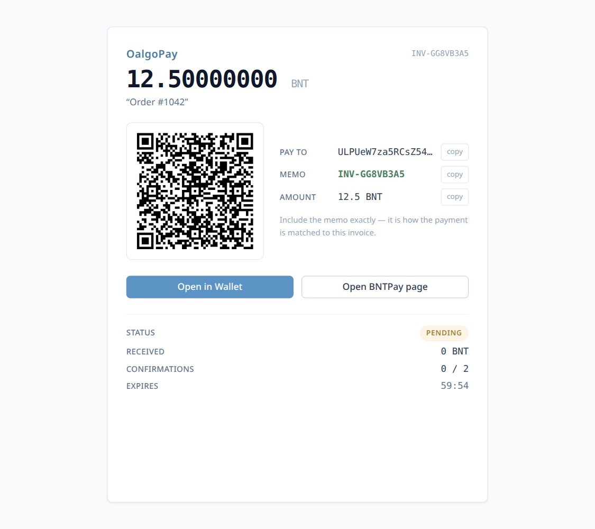
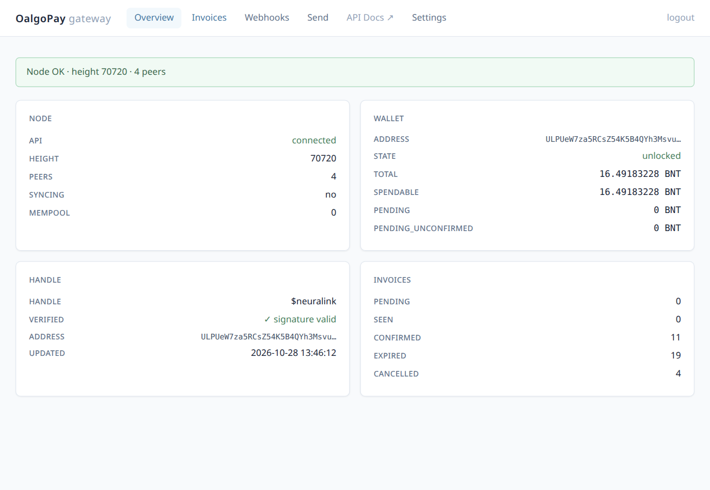
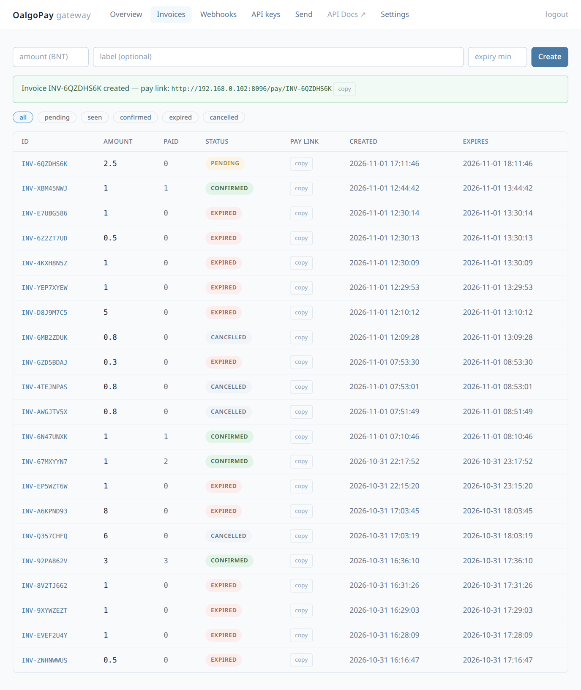
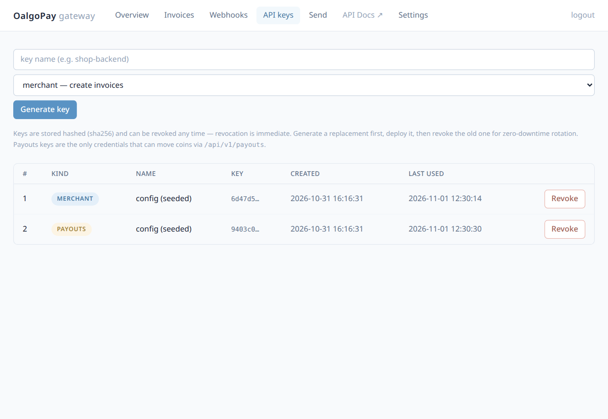
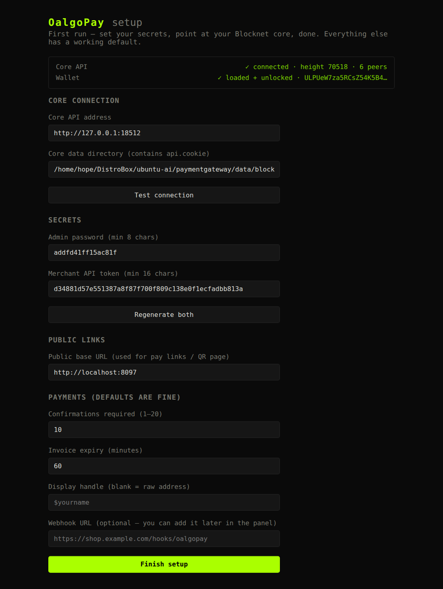

<h1 align="center">OalgoPay</h1>

<p align="center">
  Self-hosted Blocknet (BNT) payment gateway.<br>
  Merchant API · hosted pay page · signed webhooks · admin panel.<br><br>
  
  
  
  
</p>

<p align="center">
  
  
  <br>
  
  
</p>

---

## What is this?

OalgoPay turns a [Blocknet](https://github.com/blocknetprivacy) node into a
payment processor you fully control: create invoices from your shop, give
customers a clean hosted pay page (QR, `blocknet://` one-tap, bntpay.com
link), watch the chain for their payment, and get cryptographically signed
webhooks the moment money is seen and confirmed. No third party, no custody —
your node, your wallet, your gateway.

```
Blocknet core (headless) ──api.cookie──▶ watcher (SSE + poll) ──▶ SQLAlchemy (SQLite default)
                                                │
              merchant REST API ◀────────────── ┴──▶ signed webhooks ──▶ your shop
              hosted pay page (/pay/{id}, QR)
              admin panel (/admin)
```

Storage is SQLite at `data/gateway.db` by default (WAL). Point the
`database_url` config key — or the `OALGOPAY_DATABASE_URL` env var — at
another SQLAlchemy URL (e.g. PostgreSQL) to move it; schema migrations run
automatically on boot either way.

## Features

| | |
|---|---|
| **Invoices** | `INV-` ids double as payment memos; BNT or atomic amounts (≤ 8 dp); labels + arbitrary metadata; forward-only lifecycle `pending → seen → confirmed` (+ `expired`, `cancelled`) |
| **Pay page** | QR of the `blocknet://` URI, copy buttons, live status, countdown, "Open in Wallet", bntpay.com link, blocknet explorer links on payments — htmx-polled, no page reloads |
| **Matching** | memo-first; optional exact-amount fallback (oldest unpaid invoice); idempotent by txid+output; overpaid / underpaid / late-payment flags |
| **Webhooks** | `payment.seen`, `invoice.confirmed`, `invoice.expired` (+ manual resend, test pings); `event_id` for dedupe, `previous_status` for transitions; HMAC-SHA256 signatures with timestamp binding; retries 30 s → 2 h |
| **Admin panel** | node/wallet/handle health, invoice CRUD + manual confirm, webhook management + delivery log, manual payouts with audit trail, API key management, live settings |
| **Setup wizard** | first run at `/setup`: detects your core, live-tests the connection, generates secrets — no config editing required |
| **Payouts API** | separate payouts key + `POST /api/v1/payouts` with client idempotency keys — retry-safe automation that can never double-pay |
| **Sign-in API** | `auth` key + `POST /api/v1/auth/challenge|verify` — "Sign in with Blocknet wallet" for your other services, without hosting their own node |
| **API keys** | panel-managed merchant/payouts/auth credentials — hashed at rest, revocable, shown once; kind isolation (invoice keys ≠ coin-movement keys ≠ sign-in keys) |
| **API docs** | OpenAPI at `/docs` + `/redoc`, typed schemas, working Authorize button |
| **Examples** | three FastAPI demos in `examples/` — digital goods shop, API credit top-up, automated payouts |
| **Self-contained** | one directory: app, core binary, chain data, wallet. Nothing phones home. |

## Quick start

1. Install [uv](https://docs.astral.sh/uv/) and Python 3.14+, then:

   ```bash
   uv sync
   uv run run.py
   ```

   Prefer Docker? `cp config.example.json config.json && docker compose up -d --build`
   — core + gateway containers, wallet flow included ([docs/DOCKER.md](docs/DOCKER.md)).

2. Open `http://localhost:8096` — the [setup wizard](docs/INSTALL.md) walks
   you through the rest: core address, secrets (generated for you),
   public URL, payment defaults.

3. Start (or point at) a Blocknet core and load your wallet — the wizard's
   connection test tells you exactly what's missing.

<p align="center">
  
</p>

> **Core binary:** download the daemon-only build that matches your chain
> data from [blocknetprivacy/core](https://github.com/blocknetprivacy/core)
> releases (verify against `SHA256SUMS.txt`) — see [bin/README.md](bin/README.md).

### Create your first invoice

```bash
TOKEN=…   # a merchant API key (admin panel → API keys tab)

curl -s -X POST localhost:8096/api/v1/invoices \
  -H "Authorization: Bearer $TOKEN" -H 'Content-Type: application/json' \
  -d '{"amount_bnt":"12.5", "label":"order 1001", "metadata":{"cart_id":1001}}'
```

The response carries everything you need: `pay_url` (the link to give the
customer), the `blocknet://` URI, a bntpay.com checkout, and the QR. Full
reference: **`/docs`** on your running gateway, or [docs/API.md](docs/API.md).

### Send your first payout

Payouts use a **separate API key** — not the merchant token above. This is
deliberate: apps that create invoices cannot move coins. You need a
`payouts` key from the admin panel (**API keys** tab → Generate → kind:
`payouts`). It's shown once — store it securely.

```bash
PK=…   # payouts API key (admin panel → API keys → kind: payouts)

curl -s -X POST localhost:8096/api/v1/payouts \
  -H "Authorization: Bearer $PK" -H 'Content-Type: application/json' \
  -d '{"address":"ADDRESS…", "amount_bnt":"1.25", "memo":"withdrawal #77",
       "idempotency_key":"withdraw-77"}'
```

**The `idempotency_key` is what makes this safe for automation** — it's
your own identifier for this payout. If your script retries (network
timeout, crash, deploy), sending the exact same request returns the
original result with `"replayed": true` instead of sending coins twice.
Use a unique key per logical payout (e.g. `withdraw-{user_id}-{timestamp}`).

```json
{
  "txid": "876c6f6d…",
  "amount_atomic": 125000000,
  "fee_atomic": 69370,
  "idempotency_key": "withdraw-77",
  "replayed": false
}
```

Check status and history:

```bash
curl -s -H "Authorization: Bearer $PK" localhost:8096/api/v1/payouts?limit=10
curl -s -H "Authorization: Bearer $PK" localhost:8096/api/v1/payouts/4
```

### Verify your first wallet sign-in

Sign-in verification uses a **separate `auth` API key** — server-to-server
only, never in browser code. This is what lets your *other* services (faucet,
forum, dashboard) offer "Sign in with Blocknet wallet" without hosting their
own node. You need an `auth` key from the admin panel (**API keys** tab →
Generate → kind: `auth`). It's shown once — store it securely.

```bash
AK=…   # auth API key (admin panel → API keys → kind: auth)

# 1. mint a single-use challenge (your backend)
curl -s -X POST localhost:8096/api/v1/auth/challenge -H "Authorization: Bearer $AK"
# → {"nonce":"9f86d081…","message":"oalgopay:login:9f86d081…","expires_at":1793218743}

# 2. show `message` to the user — their Blocknet wallet signs it
#    ("sign message" feature)

# 3. verify the address+signature pair they hand back
curl -s -X POST localhost:8096/api/v1/auth/verify \
  -H "Authorization: Bearer $AK" -H 'Content-Type: application/json' \
  -d '{"nonce":"9f86d081…", "address":"ADDRESS…", "signature":"<128 hex chars>"}'
```

```json
{"nonce": "9f86d081…", "address": "ADDRESS…", "verified": true}
```

**The `oalgopay:login:<nonce>` message is what blocks replay** — the nonce is
globally single-use and the prefix is fixed, so a signature obtained for any
other site's challenge can never verify here. On `verified: true`, log the
user into *your* service (`address` is the identity); the challenge is burned
— replaying it returns 400. A 503 means the node was unreachable and
**nothing was consumed**: retry the same nonce. Full reference and the
error/lockout table: [docs/API.md](docs/API.md).

### Receive webhooks

```json
{
  "event_id": "evt_ff9274aea3289f25",
  "event": "invoice.confirmed",
  "event_created_at": 1793329011,
  "previous_status": "seen",
  "invoice": { "…": "…" }
}
```

Signed with `X-OalgoPay-Signature: t=<unix>,v1=<hex>` —
`v1 = HMAC-SHA256(secret, "<t>." + raw_body)`. Verification snippets and the
retry/dedupe contract: [docs/WEBHOOKS.md](docs/WEBHOOKS.md).

---

## Documentation

- [Installation & Operations](docs/INSTALL.md) — first start, systemd, backup/restore, upgrades, troubleshooting
- [Merchant API Reference](docs/API.md) — every endpoint, schema, and error
- [Webhooks Guide](docs/WEBHOOKS.md) — events, payloads, signature verification, testing
- [Admin Panel Guide](docs/ADMIN.md) — invoices & matching rules, payouts, settings
- [Persistence Internals](docs/DATABASE.md) — SQLAlchemy 2.x design notes: entities vs Core, detached instances, migrations
- Interactive OpenAPI: `/docs` (Swagger UI) and `/redoc` on the running gateway

## Security

- The core API stays localhost-bound; the gateway authenticates with the
  regenerated `api.cookie` and holds **no wallet keys** — wallet loads are
  explicit (wizard/panel), or the opt-in `OALGOPAY_WALLET_PASSWORD_FILE`
  auto-reload for unattended core restarts (password used once, never stored).
- Only the admin panel's Send feature can move coins (admin session required);
  the merchant API is create/read-only.
- Keep `config.json`, `data/`, and `shop.wallet.*` private (600/0700) — they
  are git-ignored by design. Serve the panel over TLS before exposing the
  gateway beyond your LAN.

## Tests

```bash
uv run python -m unittest          # or: uv run pytest
uv run python scripts/e2e_test.py  # real-money end-to-end: pay → seen → confirmed → signed webhooks
```

## License

[MIT](LICENSE)
