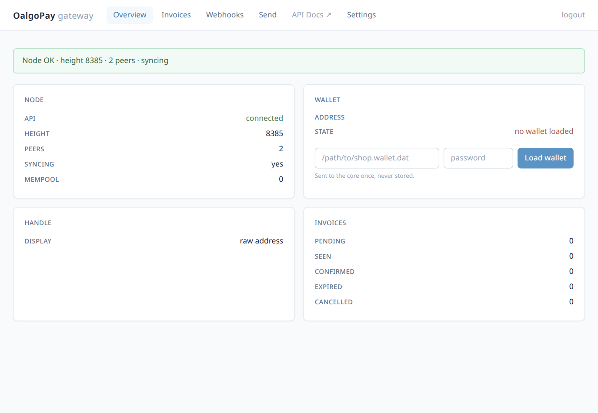

# Running OalgoPay with Docker

One image, two containers: `core` (the Blocknet core) and `gateway`. A shared
Docker volume holds the chain data **and** `api.cookie`, so the gateway can
authenticate to the core exactly like on bare metal. The first-run setup
wizard works unchanged — it just runs inside the gateway container.

## Quick start

```bash
git clone https://github.com/mufalito/oalgopay.git && cd oalgopay

# placeholder config → the gateway boots in setup mode
cp config.example.json config.json

# put your wallet somewhere the core container can read (rw: the core saves it)
mkdir wallets && cp /path/to/shop.wallet.dat /path/to/shop.wallet.pw wallets/

docker compose up -d --build
```

Open **http://localhost:8096** — the wizard prefills `http://core:18512` and
`/app/data/blocknet` automatically (via `OALGOPAY_API_BASE`/`OALGOPAY_DATADIR`).

Bare-metal installs listen on loopback while unconfigured; the compose file
sets `OALGOPAY_UNCONFIGURED_BIND=0.0.0.0` because a published port only
works with an all-interface bind inside the container (the core's API stays
private to the compose network).

## Wallet in Docker

Container paths matter: the wallet lives at **`/wallets/<file>`** inside the
core container — use that path in the wizard and the panel's Load-wallet form.

1. Wizard (or panel) → wallet path `/wallets/shop.wallet.dat` + password
2. The gateway writes `wallet_file` into the core's settings and tells you a
   restart is needed
3. `docker compose restart core`
4. Admin panel → Overview → **Load wallet** → same path + password → done

<p align="center">
  
</p>


Later core restarts keep `wallet_file` configured, so loading works without
the settings step.

## What lives where

| Path (host) | Path (container) | Purpose |
|---|---|---|
| docker volume `oalgopay-data` | `/app/data` | chain db, `api.cookie`, gateway db + session secret |
| `./config.json` | `/app/config.json` | gateway config — written by the setup wizard, persists on host |
| `./wallets/` | `/wallets` (core) | your wallet files — never committed, keep backups |

## Ports

| Host | Container | Service |
|---|---|---|
| 8096 | 8096 | gateway (panel, pay pages, API) |
| 28080 | 28080 | core p2p (optional, helps sync/relay) |

The core's API (18512) is **not** published to the host — it stays on the
compose network between the two containers.

## Operations

```bash
docker compose logs -f gateway          # tail gateway logs
docker compose restart core             # after wallet_file changes
docker compose pull && docker compose up -d --build   # upgrade
docker compose down                     # stop (data persists in the volume)
docker compose down -v                  # stop AND wipe the volume (chain re-syncs)
```

Backups: copy `config.json`, `wallets/`, and back up the volume
(`docker run --rm -v oalgopay-data:/data -v $PWD:/backup alpine \
tar czf /backup/oalgopay-data.tgz /data`).

## Notes

- The image builds the core in from the official release, sha256-verified at
  build time (`ARG CORE_VERSION=0.22.0` to pin another).
- TLS: put a reverse proxy (Caddy/nginx) in front of 8096 before exposing
  the panel publicly.
